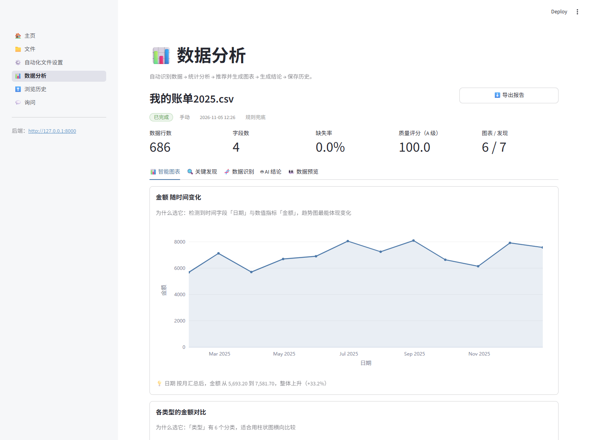

# 待业在家，我给自己造了个电子室友，它只会看表格

> 不领工资、不问前程、不催我投简历。就是偶尔把金额当成身份证号。

## 一、待业的第 N 天，我决定干点正事

早上十点醒的。

窗帘没拉，光从缝里切进来一条，正好落在显示器上。我躺在床上刷手机，刷到记账软件弹了个年度报告：过去一年，你一共花了……

我没点开。我怕。

但好奇心这东西，你越躲它越痒。我爬起来，把账单导成 CSV，想自己算一遍。

双击打开，一片乱码。

真的是一片，那种“锟斤拷”式的乱码。折腾了半个小时，换编码、换分隔符、把文件另存了三次，终于看清那堆数字。

结论是：外卖占了一半。

我关掉表格，坐了一会儿，觉得这半小时花得有点冤。

更冤的是，我突然反应过来——这半小时我干的事，下个月还会再干一遍。

## 二、于是我决定造个东西

我没有工作，但我有很多表格。

记账的、体重的、追番进度的、网购订单的、某个游戏导出的掉落记录……格式各异，散在几个文件夹里。每次想看点什么，都要重新折腾一遍。

于是我做了个决定：写个东西，以后不管什么表，扔进去就行。

注意，这不是勤奋。这是懒。**懒到愿意花两个星期，只为以后每个月省半小时。**

我管它叫电子室友。

它没有形象，没有声音，住在电脑里，工作内容只有一条流水线：你扔个表进去，它认字、体检、找关系、挑图、画图、写几句人话，然后存档。

## 三、它的第一份工作：算我这一年点了多少外卖

第一次跑通的时候，我把那份外卖账单扔了进去。

三十秒后，它给我六张图、九条“发现”。

第一条：某个月的外卖支出，占当月总支出的 63%。

第二条：周三晚上点得最多。

第三条：有一家店，我一年点了四十多次。

我看着第三条，沉默了很久。它没有评价我，只是陈述事实——但那个数字比任何人的劝都管用。

那天晚上我煮了面。

第二天又点了外卖。

## 四、翻车一：001 变成了 1

电子室友上班第一天就出了事故。

账单里有一列“订单号”，长这样：`001`、`002`、`003`。它读进去，变成了 `1`、`2`、`3`。

看起来没什么，直到我想按订单号去找某笔退款，发现全对不上。

原因很朴实：读表的库太聪明，看到一列数字就自动当数字处理，前导零顺手扔了。它不知道那三个零是我用来排序的。

解决办法也朴实：**先全部当字符串读，再自己一列一列判断类型。**

> 教训一：别太相信一个“聪明”的工具。它聪明，但它不懂你的习惯。

## 五、翻车二：它把金额当成了身份证

我给“这是不是编号”定了条规则：唯一、而且是连续整数，就当编号处理，不参与计算。

听起来很严谨。

结果它把我的**连续记账天数**认成了身份证——因为那一列是 1、2、3、4……唯一、连续、整数，完美命中。

于是“连续天数”从指标里被踢了出去，趋势图当场失去主角。它还一本正经地给我画了一张“编号随时间变化”的图。

我盯着那张图看了半分钟，开始怀疑我们俩到底谁有问题。

后来加了条件：连续整数还必须从 0 或者 1 开始，才算行号。

> 教训二：规则写得越“聪明”，越容易聪明反被聪明误。

## 六、翻车三：删了文件，鬼还在

有天我删了一个测试文件，顺手清空了列表。

然后去历史页面一看：一条记录还飘在那儿，文件名显示“未知文件”。

像极了分手之后还留着的聊天记录。

原因是数据库默认不开外键约束。所以“删文件时顺手删掉它的分析记录”这句配置，**从来没生效过**。

补上一句开关，外加删除时手动再清一遍。

> 教训三：配置写了不等于生效，就像计划做了不等于执行。

## 七、翻车四：它有时差，八小时那种

刚做好的那几天，我总觉得它时间不对。

我凌晨一点分析完，历史里显示下午五点。我一度以为是它偷偷加班，还挺感动。

真相是：数据库存的是 UTC，接口原样返回，页面原样显示。于是“刚刚”变成了“八小时前”。

凌晨一点和下午五点，中间隔着的是一个没有工作的人的一整天。

> 教训四：时间是最容易糊弄、也最容易露馅的东西。

## 八、它不是聪明，它只是不怕麻烦

很多人一听“AI 自动分析”，第一反应是：那模型挂了怎么办？

我的答案是：**它挂了，活儿照样干。**

模型只负责最后一嘴——写结论。没配 Key，用规则模板拼一份；Key 过期了，同上；模型返回半截 JSON，把能用的留下，缺的用规则补。

页面上会老老实实标一句“模型生成”或者“规则兜底”。不装，也不骗。

它不会替我想“这个数据说明了什么人生道理”。它只会说：某个月 63% 的支出是外卖。

剩下的，我自己想。

## 九、现在的日常

现在的日常是这样的：

早上起来，泡一杯咖啡，把前天导出的表扔进去，点一下。

三十秒后，六张图、七条发现，一段人话结论。

我不一定每天都看。但我知道它在。

有时候翻历史记录，像翻一本别人替我写的日记。记的不是心情，是数字：这个月比上个月少点了十二次外卖，体重那一栏终于不再是平的，某个游戏我连续登录了八十九天然后断了。

这些事我自己不会记，它替我记着。

## 十、结尾

它不会说话，不会安慰我，也不会问我“工作找得怎么样了”。

它只是每天早上准时把昨天扔进去的东西看完、存好，等我哪天想起来去翻。

我没工作，但它有。

至于我，简历还是要投的。

……等我先把下个月的外卖账单导出来。

---

> 技术栈：Python 3.13 / Streamlit / FastAPI / pandas / Plotly / SQLite。代码扔在 GitHub 上，仓库叫 `ai-auto-analyzer`。
