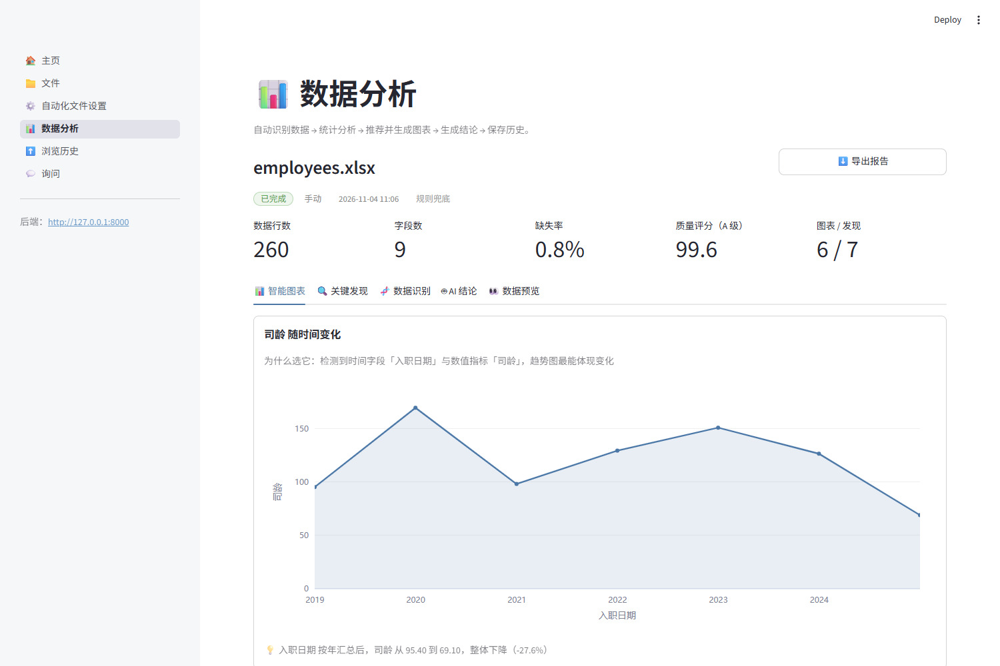

# 我给自己招了个电子实习生，它只会干一件事：看表格

> 不领工资、不请假、不摸鱼。就是偶尔把销量当成身份证号。

## 一、每周五下午五点，它准时出现

周五下午五点，微信响了。

同事发来一个 20MB 的 CSV，附言四个字：**帮我看看**。

这四个字的信息量为零。看什么？看多少？看完了要干嘛？但你不能问。问了就是“你是专业的”。

我打开看了一眼：字段名一半中文一半英文，日期一栏 `2024/1/1` 和 `2024-01-01` 混着住，金额带千分位，还有 6% 的格子是空的。

然后我做了所有正常人都会做的事：先去泡了杯咖啡。

咖啡喝完，我开始洗数据、试图、写结论。等我抬头，天黑了，整层楼只剩我和保洁阿姨。

最气人的不是加班。最气人的是，**下周五它还会再来一次**。一模一样的四个字，一模一样的两处空格。

## 二、我不是勤快，我是懒出了方法论

那天晚上我躺在床上想：这活儿我到底干过多少遍了。

洗数据、算两笔、挑个图、憋三句话。每次流程一样，每次都要从零开始。这不叫工作，这叫“每周手动重启一次”。

于是我做了个违背祖训的决定：花两个星期，写个东西，专门替我干这件事。

注意，这不是勤奋，这是懒。**懒到愿意花两周，只为以后每周省两小时。**

我管它叫我的电子实习生。

它的工作内容只有一条流水线：你扔个表进去，它认字、体检、找关系、挑图、画图、写几句人话，然后存档。

## 三、入职第一天，它把 001 叫成了 1

实习生上班第一天就出了事故。

我们有一列“编号”，值是 `001`、`002`、`003`。它读进去，变成了 `1`、`2`、`3`。

看起来没什么，直到你发现所有订单号都对不上。

原因很朴实：读表的库很聪明，看到一列数字就自动当数字处理，前导零顺手扔了。它不知道那三个零是业务的一部分。

解决办法也朴实：**先全部当字符串读进来，再自己一列一列判断类型。** 多花一点算力，换来编号不失真。

> 教训一：别太相信一个“聪明”的工具。它聪明，但它不懂你的业务。

## 四、它把销量当成了身份证

第二个事故更有意思。

我给“这是不是编号”定了条规则：唯一、而且是连续整数，就当编号处理，不参与计算。

听起来很严谨。结果它把**销量**认成了身份证。

因为那一列是 10、11、12……唯一、连续、整数，完美命中。

于是销量从“指标”里被踢了出去，趋势分析当场失去主角。它还很认真地给我画了一张“编号随时间变化”的图。

我盯着那张图看了半分钟，开始怀疑人生。

后来加了个条件：连续整数还必须从 0 或者 1 开始，才算行号。销量从 10 开始的，乖乖当指标。

> 教训二：规则写得越“聪明”，越容易聪明反被聪明误。

## 五、删了文件，鬼还在

有天我删了一个测试文件，顺手清空了列表。

然后去历史页面一看：一条记录还飘在那儿，文件名叫“未知文件”。

像极了分手之后还留着的聊天记录。

原因是数据库默认不开外键约束。所以“删文件时顺手删掉它的分析记录”这句配置，**从来没生效过**。

补上一句开关，外加删除时手动再清一遍。双保险，毕竟老库可能没开。

> 教训三：配置写了不等于生效，就像计划做了不等于执行。

## 六、它有时差，八小时那种

刚上线那几天，我总觉得它时间不对。

我十一点分析完，历史里显示凌晨三点。我一度以为它在偷偷加班，还挺感动。

真相是：数据库存的是 UTC，接口原样返回，页面原样显示。于是“刚刚”变成了“八小时前”。

现在的做法：入库统一 UTC，返回时带上时区标记，页面转成本地时间再显示。

> 教训四：时间是最容易糊弄、也最容易露馅的东西。感情也是。

## 七、它有个原则：AI 是顾问，不是爹

很多人一听“AI 自动分析”，第一反应是：那模型挂了怎么办？

我的答案是：**它挂了，活儿照样干。**

这套东西里，模型只负责最后那一嘴——写结论。没配 Key，用规则模板拼一份；Key 过期了，同上；模型返回半截 JSON，把能用的留下，缺的用规则补。

页面上还会老老实实标一句“模型生成”或者“规则兜底”。不装，也不骗。

我把它理解成公司里的顾问：有他，报告好看一点；没他，会照开。

## 八、现在的日常

现在同事再发文件，我回一句：“传上去，点分析。”

三十秒后，屏幕上出现六张图、九条发现，还有一段说人话的结论。

906 行的表，从点击到出结果，0.4 秒。比我双击打开 Excel 的时间还短。

对方通常会沉默三秒，然后问：“这什么工具？”

我说：“我写的。”

那一刻的爽感，大概能抵消两周的加班。

虽然我并没有真的少加班——因为周五五点的 CSV 依旧准时。

## 九、一些不体面的真相

它也不是万能的。说几个丢人的地方：

- 它只认字面意思，问得太绕就开始胡说，得配个正经的向量模型才像样；
- 几十万行的表会让它卡住，因为分析是同步的，浏览器只能干等；
- 一个 Excel 里有好几个工作表时，它只分析最大的那个；
- 没有登录、没有多用户，属于“自己用刚好、扔公网要命”的类型。

说白了，它是个称手的家用工具，不是企业级产品。我也没打算把它做成产品，我只需要它别在周五晚上给我添乱。

## 十、结尾

写这东西的两周里，我最大的收获不是学会了什么新技术，而是想明白一件事：

**很多“专业能力”，其实只是重复劳动的别名。**

一旦你把重复的部分拆开、写成规则，它就不再需要你了。这话听着有点伤感，但换来的是一杯不用凉的咖啡。

现在它还在我电脑上跑着。每天早上我打开电脑，它会自己去文件夹里看看有没有新表，有就默默分析完，存进历史。

像一个不太会说话、但从不迟到的同事。

至于我，周五五点终于可以准时走了。

……只要那天的 CSV 别太大。

---

> 技术栈：Python 3.13 / Streamlit / FastAPI / pandas / Plotly / SQLite（可切 PostgreSQL + pgvector）。代码在 GitHub 上，搜索 `ai-auto-analyzer` 就能找到。
