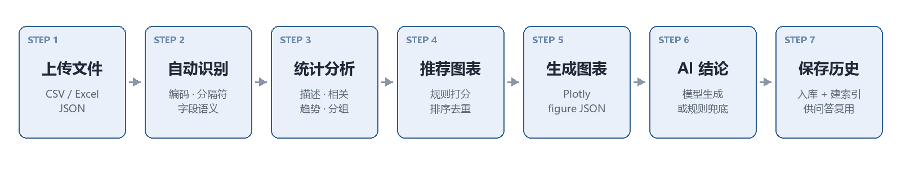
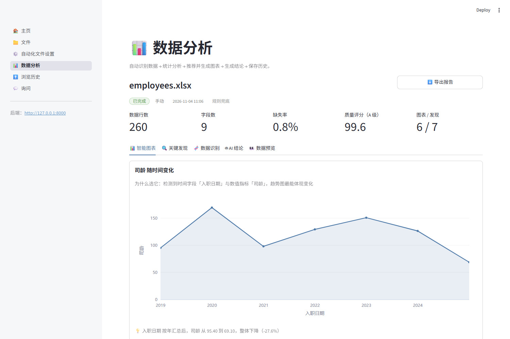
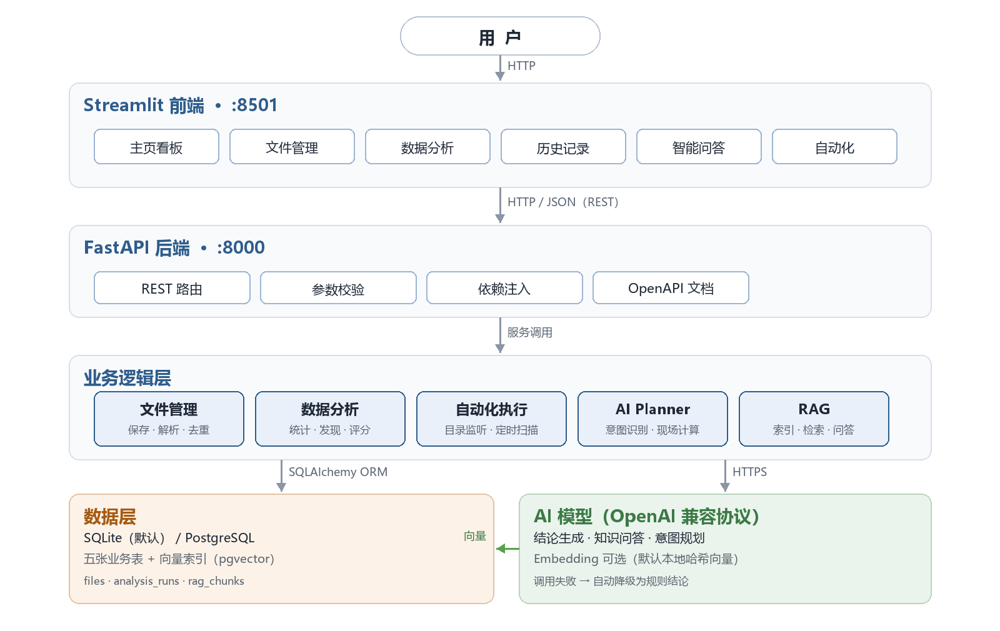

# 以后再有人甩给我一个 Excel 说“帮我看看”，我就把这个系统甩给他

> 一个「上传 → 识别 → 分析 → 出图 → 写结论」的小系统。没有 BI 的拖拽，也没有“再等一下我马上出图”。

先交代一下背景。

周五下午五点，同事发来一个 20MB 的 CSV，附言四个字：**帮我看看**。

这四个字包含的信息量约等于零。看什么？看多少？看完了要干嘛？但你不能问，问就是“你是专业的”。

于是我打开了它：字段名一半中文一半英文，日期是 `2024/1/1` 混着 `2024-01-01`，金额带千分位，还有 6% 的格子是空的。等我把数据洗干净、试了三种图、憋出三句结论，天已经黑了。

**这件事最荒谬的地方在于：下周同样的表还会再来一次。**

所以我把这条链路做成了一个系统。你只管上传，剩下的交给它。

## 它到底干了啥

一句话版本：

> 上传 CSV / Excel → 它自己认出这是什么数据 → 自己算 → 自己挑图 → 自己画 → 自己写几句人话结论 → 存档。

换成流程图大概长这样：

七个关卡，全部自动。906 行的销售数据，从点“开始分析”到看见 6 张图加 9 条发现，**0.4 秒**。

对，比我双击打开 Excel 的时间还短。

## 为什么不用现成的 BI 工具

因为我懒，而且懒得很具体。

BI 工具的问题是：**你得先知道你要看什么**。拖一个字段到 X 轴，再拖一个到 Y 轴，发现不对，换一个，再换一个。这个过程本质上还是人肉试错，只不过把 Excel 换成了另一个软件。

我想要的是另一种交互：**我不知道要看什么，你先告诉我这数据有什么好看的。**

所以这套系统的默认动作不是“等你拖拽”，而是“先自己看一遍，把值得看的端上来”。

## 把流水线拆开看

### 第一关：认字

系统拿到的第一手材料是一堆字节。它得先搞清楚三件事：这文件什么编码、用什么分隔符、哪一行是表头。

听起来很简单，直到你遇到：

- 一份 GBK 编码的 CSV，用 UTF-8 打开全是乱码；
- 一份用分号分隔的文件，被当成“只有一列”；
- 一份 Excel，前两行是“XX 公司 2024 年销售报表”这种大标题，第三行才是表头。

这些都有对应的兜底：编码按 utf-8-sig → utf-8 → gb18030 → gbk → big5 依次试；分隔符先嗅探，猜错了再按“哪种分隔符切出来的列最多”重试；表头用打分法找，谁最像表头就让谁当表头。

> 说人话：先确保自己认对了字，再谈理解意思。

### 第二关：给字段发工牌

接下来给每一列发工牌：你是时间、你是指标、你是分类、你是编号、你只是段文字。

这步看着像分类游戏，其实决定了后面所有事：

- 有**时间**列，才有可能画趋势；
- 有**指标**列，才有可能算均值、找异常；
- 有**分类**列，才有可能做分组对比。

工牌发错了，后面全歪。比如把“订单号”当成数值指标，系统就会兴致勃勃地告诉你“订单号均值 20240115.3”——毫无意义，但很像个 bug。

所以规则里加了一条：以 0 开头、或者长度超过 12 位的纯数字，一律当编号处理，不许参与计算。

### 第三关：体检打分

数据也是有健康度的。系统会给它做个体检，从 100 分往下扣：

- 缺失多，扣；
- 重复行多，扣；
- 有一整列永远是同一个值（比如“状态”全是“完成”），也扣。

最后给个 A / B / C / D 的等级。A 表示这数据挺干净，D 表示建议先回去找数据源聊聊。

这个分数不是玄学，公式写死在代码里，改一个系数就能调松紧。

### 第四关：找关系

体检完，开始正经分析。四件事：

1. **谁和谁有关系**：两两算相关系数，只把 |r| ≥ 0.6 的放进“值得说”的发现里；
2. **时间上怎么变**：按数据跨度自动选日/月/年粒度，算首尾变化，还顺手算个拟合度；
3. **谁强谁弱**：按分类维度聚合，看头部占比和组间差距；
4. **谁不正常**：用 1.5 倍四分位距找离群值。

然后用这些结果拼出“发现”，每条打个分，按重要程度排序。

> 小细节：趋势图默认挑“总量最大”的指标，不是“涨幅最大”的。
> 因为销量从 10 涨到 69 是 +590%，看起来很刺激，但业务上真正该看的是销售额。百分比会骗人，绝对值不会。

### 第五关：选图（不许全是柱状图）

这一步是整个系统里我最喜欢的部分。

系统会根据字段组合生成一堆候选图，每张图带一个基础分：

| 你有什么 | 它画什么 | 为什么 |
| --- | --- | --- |
| 时间 + 指标 | 折线图 | 趋势最直观 |
| 分类 + 指标 | 柱状图 | 比大小 |
| 分类很少 + 指标 | 饼图 | 看结构占比 |
| 两个指标 | 散点图 | 看关系与离群点 |
| 三个以上指标 | 热力图 | 一屏看完全部两两相关 |
| 单个指标 | 直方图 | 看分布形态 |
| 分类 + 指标（组内离散） | 箱线图 | 看波动和异常 |

然后有个很朴素的约束：**同一种图最多两张**。

不加这条约束的话，系统会兴高采烈地给你六张柱状图。技术上没错，阅读体验上等于灾难。

### 第六关：画图

图是后端画好的，前端只负责摆盘。

具体说，后端返回的不是“数据 + 图表类型”让前端自己拼，而是直接返回一整份画好的图。前端拿到就渲染，一个像素都不用算。

好处很直接：**同一个结果，页面上看到的、历史里回看的、导出的，长得一模一样。** 不会出现“页面上一套口径、导出另一套口径”这种经典事故。

### 第七关：写结论

最后一步，让模型用中文写几句人话：整体什么情况、最值得注意的三件事、建议怎么做、有什么坑要小心。

但这里有个原则：**AI 是顾问，不是命根子。**

没配 Key？没关系，用规则模板拼一份结论，照样能看。
Key 过期了？也没关系，同上。
模型抽风返回了半截 JSON？还是没关系，能用的字段留着，缺的用规则补。

界面上会老老实实标一句“模型生成”或者“规则兜底”，不装，也不骗。

## 三个“看着不起眼但救命”的设计

**一、默认零配置**

新同学拉下代码，装完依赖就能跑。数据库默认用 SQLite，文件就在 `data/app.db`，不用装 PostgreSQL，不用建库建用户。

等数据量上来了、要并发、要向量索引了，改一行连接串就能切到 PostgreSQL + pgvector，业务代码一行不用动。

**二、AI 全程可降级**

模型调用统一包了一层，超时、报错、返回格式不对，全被吞掉并记进日志，然后走兜底逻辑。

系统不会因为“模型服务抽风”而白屏。顶多是结论朴素一点，图和分析该有还是有。

**三、检索不是纯向量**

问答用的是“向量相似度 + 关键词命中 + 字段名命中”的混合打分。

为什么要加后面两项？因为默认的本地向量比较粗糙，纯靠它召回，经常出现“问地区答渠道”这种答非所问。加上关键词和字段加权之后，命中率肉眼可见地变好。

## 踩坑实录

做这个东西的过程中踩了几个特别典型的坑，值得单独说说。

### 坑一：001 变成了 1

CSV 里有个“编号”列，值是 `001`、`002`。pandas 读进来，直接变成 `1`、`2`。

看起来无所谓，直到你发现所有订单号都对不上。

解决办法：CSV 先全部按字符串读，再自己逐列判断类型。多花一点 CPU，换来编号不失真，值。

### 坑二：递增的整数被当成了主键

判断“这是不是 ID”的规则原本是：唯一、且是连续整数。

结果销量 10、11、12……完美命中，被判成 ID，然后从指标列表里被踢了出去——趋势分析直接没了主角。

后来加了个条件：连续整数还必须从 0 或 1 开始，才算行号。销量从 10 开始的，乖乖当指标。

### 坑三：删了文件，记录还在

SQLite 默认不启用外键约束。于是“删文件时级联删除分析记录”这句配置，实际上**从来没生效过**。

表现是：文件列表空了，历史里还飘着一条“未知文件”的分析记录。

修法是连接时补一句 `PRAGMA foreign_keys=ON`，外加删除时手动再清一遍。双保险，毕竟老库可能没开。

### 坑四：时间差了 8 小时

数据库里存的是 UTC，接口原样返回，前端原样显示。于是“刚刚分析完”的记录，时间显示成 8 小时前。

现在的做法：入库统一 UTC，返回时带上 `+00:00`，前端转本地时区再显示。

> 时间是所有系统里最容易糊弄、也最容易露馅的东西。

## 现在它能干什么

- 传 CSV / Excel / JSON，自动识别编码、分隔符、表头、字段类型
- 给数据做体检，A / B / C / D 打分，列出问题字段
- 自动统计加找规律，输出 6~9 条带分数的“发现”
- 自动挑 6 张图（折线、柱状、饼、散点、热力、直方、箱线、缺失率）
- 生成结论文案（模型或者规则，二选一）
- 分析历史全量留档，可回看、可导出
- 用自然语言追问，答案带引用来源
- 监视一个目录，新文件落地自动跑完整流程

顺便说一句，它现在有 32 个自动化测试兜着，改代码不至于心惊胆战。

## 它现在还不行的地方（坦白局）

- 本地向量只做字面相似，复杂问法会露怯；配了 embedding 模型才像样。
- 分析是同步接口，几十万行的大文件会让浏览器等到怀疑人生。
- 自动化是轮询，最迟要等一个扫描间隔。
- 没有登录和多用户，适合自己用或者小团队内网用，别直接扔公网。
- 一份 Excel 有多个工作表时只分析其中一个（虽然会挑最大的那个）。

## 下一步

短期想做的：把分析改成后台任务加进度条，加批量分析，把模型 Key 做成界面上可配置的。

中期想做的：定时报表（每天早上自动跑一遍，把结论推到群里）、导出 PDF、多表关联。

长期想做的：把“销售额”“毛利率”这类口径沉淀成指标定义，别每次都重新算一遍。以及，允许用户对结论点个“说得对”或者“胡说八道”，拿反馈去调规则权重。

## 最后

这套东西没有多高深的技术，无非是把“人肉做表”的每个动作拆开、写成规则、再串起来。

但它的价值不在于技术，而在于：**下一个周五下午五点，我可以准时下班。**

---

> 技术栈：Python 3.13 / Streamlit / FastAPI / pandas / Plotly / SQLAlchemy / SQLite（可切 PostgreSQL + pgvector）。
